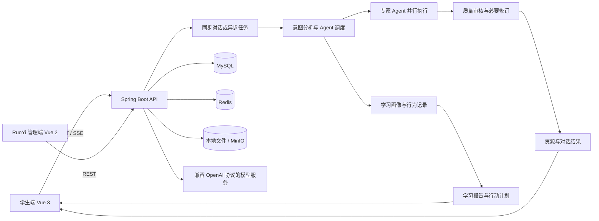

# 智学协同教育智能体平台

**IntelliLearn Agent Platform** 是一个面向自主学习场景的全栈教育 AI 项目。学生可以在一个工作区中与 AI 对话、查看智能体协作过程、生成和管理学习资源、进行题库练习，并根据学习记录查看画像与报告。项目以 RuoYi-Vue 3.9.2 为管理后台与基础框架，在其上扩展教育业务后端和独立的 Vue 3 学生端。

[](https://github.com/shibocao797-max/intellilearn-agent-platform/actions/workflows/ci.yml)
[](https://openjdk.org/)
[](https://spring.io/projects/spring-boot)
[](https://vuejs.org/)

## 项目解决什么问题

学习过程中，提问、整理资料、做练习和回顾进度往往分散在不同工具里。本项目将这些环节连接成一个可追踪的学习流程：

1. 学生在对话中描述问题、学习目标，或上传学习附件。
2. 后端分析请求并选择适合的专家 Agent；适用时并行生成答疑和学习资源。
3. 生成的资源进入质量检查流程，必要时触发修订；执行阶段和结果可以通过 SSE 或异步任务事件查看。
4. 学生继续使用资源、完成练习并确认画像结论，系统据此展示学习报告和行动计划。

项目面向学习辅助，不替代教师判断。大模型生成内容可能存在错误，重要知识和建议应由使用者核验。

## 功能

### 学生端

- **AI 学习对话**：普通问答与 SSE 流式答疑；支持会话历史、学习附件和语音转写入口。
- **Agent 协作追踪**：查看任务阶段、调度结果、Agent 状态、质量审核和资源交付轨迹。
- **异步 AI 任务**：创建任务、恢复活动任务、按序读取事件、取消任务；请求幂等键用于降低重复提交造成的重复任务。
- **学习资源**：浏览、查看和删除个人资源；资源类型包括文档、代码案例、思维导图、题目，以及图像、视频和动画等媒体资源。
- **题库与练习**：筛选题目、创建可恢复练习会话、暂存答案和当前位置、提交作答、查看结果与错题。
- **学习画像**：查看画像维度和证据，对待确认结论进行确认或拒绝。
- **学习报告与计划**：查看汇总和详细学习报告，生成、确认、归档或重新生成行动计划。
- **个人工作区**：保存学生端的工作区偏好和组织信息。

### 管理端与平台能力

- 基于 RuoYi-Vue 的用户、角色、菜单、部门、字典、通知、系统配置和运行监控管理。
- 教育资源、题库、学习行为、会话、任务事件和附件等业务数据由后端模块提供接口与持久化支持。
- 文件存储可使用本地磁盘；配置后也可使用 MinIO 存储对象。
- 支持兼容 OpenAI API 协议的文本模型配置，以及独立配置的图像、视频生成和语音识别服务。

## 系统流程



AI 请求的主要业务实现位于 `ruoyi-system` 的 `ai/graph`、`ai/agent`、`ai/task` 和 `ai/tool` 包中。当前对话及异步任务执行入口调用 `EducationGraphBuilder.executeWithProgress`，由该执行器完成意图分析、画像处理、Agent 执行、审核、学习路径与结果汇总，并通过进度回调报告过程。项目依赖 LangChain4j 进行模型调用，并包含 LangGraph4j 状态图构建和相关组件；不要将状态图依赖本身等同于所有线上请求均通过 `CompiledGraph.invoke/stream` 执行。

## 技术栈

| 层次 | 技术 |
| --- | --- |
| 后端运行环境 | Java 17、Spring Boot 4.0.3 |
| Web 与安全 | Spring MVC、Spring Security、JWT、Springdoc OpenAPI |
| 持久化 | MyBatis Spring Boot 4.0.1、MySQL 8、Druid |
| AI 集成 | LangChain4j 1.15.1、LangGraph4j 1.8.17、OpenAI 兼容接口 |
| 缓存与对象存储 | Redis 7、MinIO（可选；也可使用本地文件存储） |
| 学生端 | Vue 3.5、Vue Router、Vite |
| 管理端 | Vue 2.6、Vue Router、Vuex、Element UI、Vue CLI |
| 构建与测试 | Maven、JUnit 5、npm、GitHub Actions |

## 仓库结构

```text
.
├── ruoyi-admin/       Spring Boot 启动模块、Web 控制器与 API
├── ruoyi-system/      教育业务、AI Agent、任务、领域服务和 Mapper
├── ruoyi-framework/   安全认证、数据源、Redis 等基础框架
├── ruoyi-common/      公共工具、响应模型、异常与注解
├── ruoyi-generator/   RuoYi 代码生成模块
├── ruoyi-quartz/      定时任务模块
├── ruoyi-ui/          RuoYi 管理端（Vue 2 + Element UI）
├── edu-ai-vue3/       学生学习端（Vue 3 + Vite）
├── sql/               数据库初始化与增量 SQL 文件
├── config/            本地敏感配置示例
├── docker-compose.yml MySQL、Redis、MinIO 开发依赖
└── pom.xml            Maven 多模块父工程
```

## 环境要求

- Java 17
- Maven 3.8+
- Node.js 20（CI 使用 Node 20；学生端 Vite 8 要求 Node.js `^20.19.0` 或 `>=22.12.0`）
- npm
- Docker Desktop / Docker Engine 与 Docker Compose（用于启动依赖服务）

## 本地运行

以下步骤适用于 Windows PowerShell；其他系统可使用等价的环境变量设置方式。

### 1. 启动基础设施

在仓库根目录执行。首次运行会创建 MySQL 数据库并在**空数据卷**上执行 `sql/` 中的初始化脚本。

```powershell
$env:MYSQL_ROOT_PASSWORD = "替换为本地强密码"
$env:MINIO_ROOT_USER = "minio"
$env:MINIO_ROOT_PASSWORD = "替换为本地强密码"
docker compose up -d
```

Compose 暴露的本机端口：

| 服务 | 地址 | 用途 |
| --- | --- | --- |
| MySQL | `localhost:3308` | 默认数据库 `ry-vue` |
| Redis | `localhost:6379` | 缓存 |
| MinIO API | `http://localhost:19000` | 对象存储 API |
| MinIO Console | `http://localhost:19001` | 对象存储管理界面 |

### 2. 配置后端密钥

复制配置模板：

```powershell
Copy-Item config/local-secrets.example.yml config/local-secrets.yml
```

编辑 `config/local-secrets.yml`，至少替换 JWT 密钥、数据库密码和模型 API Key。数据库密码须与启动 Compose 时的 `MYSQL_ROOT_PASSWORD` 一致。图像、视频、语音等外部服务按需配置；不使用 MinIO 时保留 `file-storage.type: local`。

敏感配置文件已加入 `.gitignore`，不要将真实密码或 API Key 提交到 Git。

### 3. 构建并运行后端

```powershell
mvn clean package
java -jar ruoyi-admin/target/ruoyi-admin.jar --server.port=18081
```

后端默认端口是 `8080`。上面的命令显式使用 `18081`，以匹配两个前端开发服务器当前的默认代理地址；若使用默认端口，请分别把 `edu-ai-vue3/.env.development` 的 `VITE_BACKEND_TARGET` 和管理端环境变量 `VUE_APP_DEV_API` 配置为 `http://localhost:8080`。

Windows 用户也可使用 `bin/package.bat` 构建、`bin/run.bat` 启动。`bin/run.bat` 使用应用默认配置端口 `8080`。

### 4. 启动学生端

打开新的终端：

```powershell
cd edu-ai-vue3
npm ci
npm run dev
```

Vite 默认地址为 `http://localhost:5173`，默认通过 `/dev-api` 代理到 `http://localhost:18081`。

### 5. 启动管理端（可选）

再打开一个终端：

```powershell
cd ruoyi-ui
npm ci
npm run dev
```

管理端代理默认目标为 `http://localhost:18081`。本地开发登录使用初始化数据库中配置的账号；请根据自己的数据库初始化脚本确认账号信息，并在任何共享或部署环境中立即更换初始凭据。

## 配置索引

| 配置 | 路径或环境变量 | 说明 |
| --- | --- | --- |
| 应用配置 | `ruoyi-admin/src/main/resources/application.yml` | 服务端口、Redis、AI、文件存储等 |
| 数据源配置 | `ruoyi-admin/src/main/resources/application-druid.yml` | MySQL URL、用户名和密码 |
| 本地密钥 | `config/local-secrets.yml` | 从 `config/local-secrets.example.yml` 复制；不要提交 |
| MySQL | `MYSQL_URL`、`MYSQL_USERNAME`、`MYSQL_PASSWORD` | 默认连接 `localhost:3308/ry-vue` |
| 模型服务 | `AGNES_TEXT_BASE_URL`、`AGNES_TEXT_API_KEY`、`AGNES_TEXT_MODEL_NAME` | 文本模型及 OpenAI 兼容 API |
| 文件存储 | `FILE_STORAGE_TYPE` | `local` 或 `minio` |
| MinIO | `MINIO_ENDPOINT`、`MINIO_ACCESS_KEY`、`MINIO_SECRET_KEY`、`MINIO_BUCKET` | `FILE_STORAGE_TYPE=minio` 时使用 |
| 学生端代理 | `VITE_BACKEND_TARGET` | 默认 `http://localhost:18081` |
| 管理端代理 | `VUE_APP_DEV_API` | 默认 `http://localhost:18081` |

完整参数与默认值以配置文件及 `config/local-secrets.example.yml` 为准。

## 主要 API

需要登录的接口使用项目现有认证机制。完整请求参数以控制器定义及 `/swagger-ui.html` 中的 OpenAPI 文档为准。

| 功能 | 主要路由 |
| --- | --- |
| 对话与流式对话 | `POST /edu/ai/chat`、`POST /edu/ai/chat/stream` |
| 会话与历史 | `GET /edu/ai/sessions`、`POST /edu/ai/session/new`、`GET /edu/ai/conversation/{sessionId}` |
| 异步 AI 任务 | `POST /edu/ai/tasks`、`GET /edu/ai/tasks/active`、`GET /edu/ai/tasks/{taskId}`、`GET /edu/ai/tasks/{taskId}/events`、`POST /edu/ai/tasks/{taskId}/cancel` |
| 学习画像 | `GET /edu/profile`、`GET /edu/profile/detail`、`PATCH /edu/profile/dimensions/{dimensionKey}/confirmation` |
| 行动计划 | `/edu/action-plans`、`/edu/action-plans/current` 及对应生成、确认、归档和更新路由 |
| 题库与练习 | `/edu/quiz/questions`、`/edu/quiz/wrong-questions`、`/edu/quiz/sessions` 及会话作答、完成和结果路由 |
| 学习资源 | `/edu/resource/user/list`、`/edu/resource/detail/{id}` |
| 学习报告 | `GET /edu/report/summary`、`GET /edu/report/detailed` |
| 附件 | `/edu/ai/attachments` |
| OpenAPI | `/v3/api-docs`、`/swagger-ui.html` |

## 数据库初始化与安全提示

数据库脚本清单由 CI 与 `sql/` 目录进行逐文件校验：

- `01_ry_20260417.sql`
- `02_ai_init.sql`
- `03_edu_resource.sql`
- `04_sys_attachment.sql`
- `05_quartz.sql`
- `05_repair_media_urls.sql`
- `06_gen_table.sql`
- `07_edu_knowledge.sql`
- `08_edu_user_workspace.sql`
- `09_profile_trust.sql`
- `10_edu_chat_attachment.sql`
- `11_edu_action_plan.sql`
- `12_sys_notice_read_hidden.sql`
- `13_quiz_practice_session.sql`
- `14_quiz_practice_current_position.sql`
- `15_edu_ai_task.sql`
- `16_learner_profile_confirmation.sql`
- `17_quiz_practice_question_snapshot.sql`
- `18_conversation_session.sql`
- `19_edu_user_account_profile.sql`

这些文件是新库初始化脚本和项目增量 SQL，**不是可安全重复执行的版本化迁移**。其中部分文件包含 `DROP TABLE`，部分文件直接执行 `ALTER TABLE`。不要在已有或含有重要数据的数据库上直接重放整套脚本。升级前先备份，并在测试库验证具体变更。Compose 只会在 MySQL 数据卷首次初始化时自动导入脚本；已有数据卷不会自动应用后来添加的 SQL。

不要将本地密钥、真实用户数据、数据库转储或生产日志提交到公开仓库。对外部署前应配置强密码、限制管理端和数据库网络访问，并评估模型服务的数据处理策略。

## 测试与持续集成

运行后端测试：

```powershell
mvn test
```

CI 工作流 `.github/workflows/ci.yml` 会校验 SQL 清单和 Docker Compose 配置，执行 Maven 测试，并构建管理端与学生端。可单独构建前端：

```powershell
cd ruoyi-ui
npm ci
npm run build:prod
```

```powershell
cd edu-ai-vue3
npm ci
npm run build
```

## 开源基础

本项目在 RuoYi-Vue 3.9.2 基础上进行扩展。根目录 `LICENSE` 保留了 RuoYi 上游的 MIT 许可文本；RuoYi 上游说明见 [RuoYi-Vue](https://gitee.com/y_project/RuoYi-Vue)。第三方依赖仍分别受其各自许可证约束。
